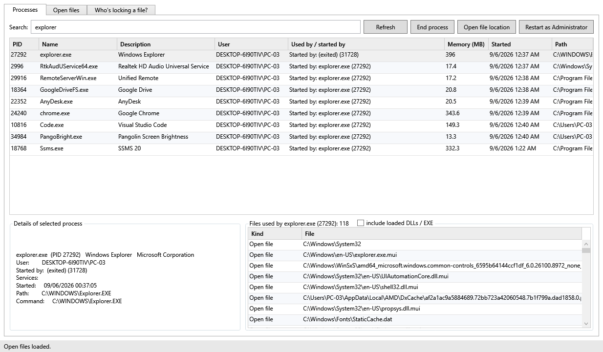
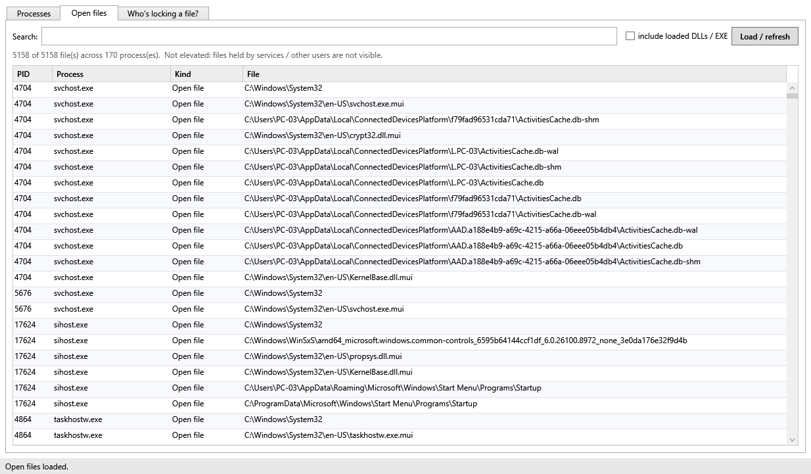
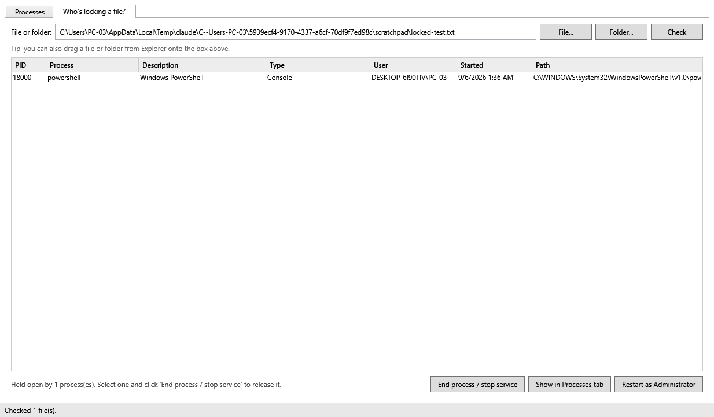
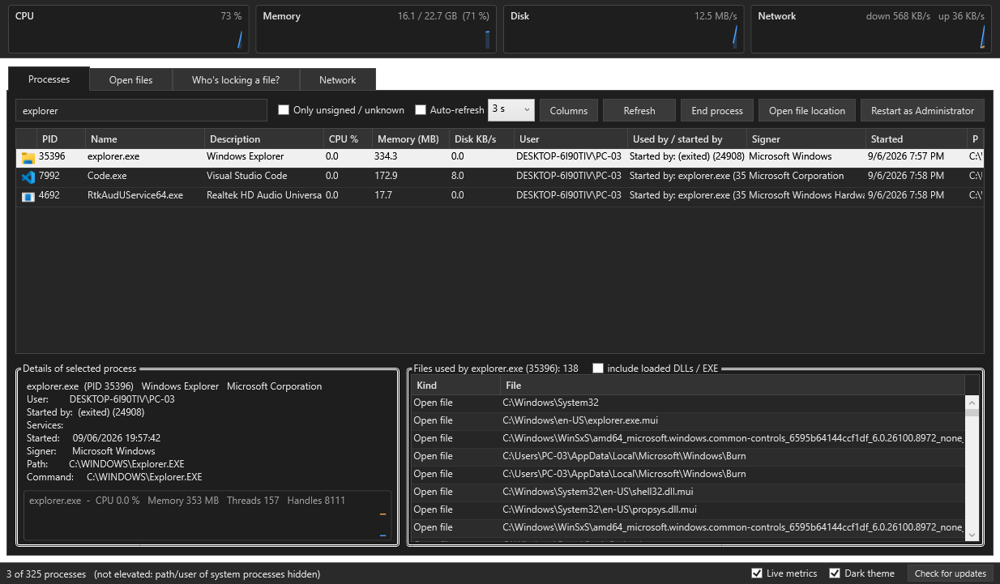
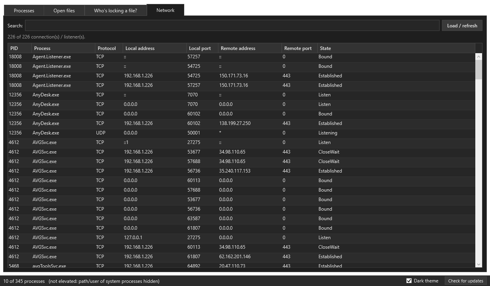

<p align="center"></p>

# Process Inspector

**"The action can't be completed because the file is open in another program."**
Process Inspector tells you *which* program, lets you end it or stop the service from the same window,
and shows what every process on the machine is used by and which files it has open.

No downloads, no drivers, no admin needed for your own processes. It is a single PowerShell/WPF app
that talks to the Windows Restart Manager and the kernel handle table, wrapped in a small .exe.

| Processes | Open files | Who's locking a file? |
|---|---|---|
|  |  |  |

| Dark theme | Network |
|---|---|
|  |  |

## Features

- **Processes tab** – every process with description, user account, memory, start time and a
  *Used by / started by* column: the services a process hosts (what is inside each `svchost.exe`)
  or the parent that started it. Live search, sortable columns, a details pane, and a panel listing
  the files the selected process has open (optionally its loaded DLLs too).
- **Open files tab** – every file every process has open, system-wide, in about a second. Search by
  file, folder or process name. Double-click to jump to the process.
- **Who's locking a file?** – drop a file or folder on the box (or use *File… / Folder…*).
  Uses the Restart Manager API, so it catches open handles *and* loaded EXE/DLL images.
  For folders it also scans the handle table, which catches the classic "a console window has
  this folder as its current directory" case and shows exactly which item is held.
  End the process or stop the service right there.
- **Single instance** – starting it again (Desktop shortcut, right-click menu, command line)
  brings the running window to the front and hands over the path instead of opening a second copy.
- **Release a file without killing anything** – close the one handle inside the other program
  (`DuplicateHandle` + `DUPLICATE_CLOSE_SOURCE`, the Unlocker trick). Available on the lock tab and on
  every file list. Or schedule a stuck file for **deletion at the next reboot**.
- **Partial-name search** – type part of a name instead of a path on the lock tab and every open handle
  on the machine is searched for it.
- **Network tab** – TCP connections and UDP listeners per process, searchable by process, address,
  port or state.
- **Live metrics** – a strip with CPU, memory, disk and network sparklines sampled every second
  through native calls (no performance counters, so it works on any Windows language), and a live
  CPU / memory chart for the selected process. Can be hidden.
- **Live view** – optional auto-refresh (2 to 10 s) with CPU %, Disk KB/s, Threads and Handles
  columns; new processes are highlighted green and exited ones red for one cycle. Selection, sort
  order and scroll position survive refreshes. Per-path data (descriptions, icons, signers) and
  per-process users are cached, so a refresh costs a fraction of the first load.
- **Process icons**, search placeholders, a column chooser, row tooltips with the full command line,
  `Esc` to clear a search box.
- **Unknowns made visible** – a user, path or signer that cannot be read shows as *(unknown)* instead
  of a blank, and *Only unsigned / unknown* filters the list down to processes nobody vouches for.
- **Signer column** – Authenticode signer of every process (or *Unsigned*), plus one-click
  *Check file on VirusTotal* (SHA-256 is computed locally and copied to the clipboard).
- **Right-click menus** on every list: end process, end process tree, restart process, stop or restart
  hosted service, run as different user, show files / network connections, go to parent, open file
  location, search online, copy PID/name/path/command line, copy as table, export to CSV, properties.
  `Del` ends, `F5` refreshes, `Ctrl+F` focuses search, `Ctrl+C` copies rows.
- **Dark theme**, remembered together with the window size and the auto-refresh setting.
- **Check for updates** against this repository's GitHub Releases (on demand only, nothing phones home).
- **Administrator aware** – files held by services (SQL Server, antivirus, Windows services) are
  invisible to a normal user. The app detects the access-denied case and offers to restart elevated.
- **System tray** – optional autostart at logon, minimised to the tray. Left-click opens the window,
  right-click gives quick actions.
- **Safe by default** – every end/stop action asks first, services are stopped properly instead of
  killed, and critical system processes are refused.

## Install

Download `ProcessInspector-Setup.exe` from the [Releases](../../releases) page and run it.
It installs for the current user only (no admin prompt) into
`%LOCALAPPDATA%\Programs\ProcessInspector` and lets you choose:

- Desktop shortcut and Start Menu entry
- Start automatically at sign-in (in the system tray)
- "Who's locking this?" in the right-click menu of files and folders

Uninstall from **Settings › Apps › Installed apps**, or run `Uninstall.ps1`.

Unattended: `ProcessInspector-Setup.exe -Silent [-NoAutostart] [-ContextMenu] [-NoDesktop] [-NoLaunch]`

### Portable

Unzip `ProcessInspector-portable.zip` anywhere and run `ProcessInspector.exe`.
Drag a file onto `ProcessInspector.exe` (or run `ProcessInspector.exe -Path "C:\some\file"`) to open
straight on the *Who's locking* tab. `-Tray` starts hidden in the tray.

### Command line

The same engine is available as plain scripts:

```powershell
.\WhosLocking.ps1 "C:\Program Files\App\app.exe"      # who holds this file / folder / exe
.\OpenFiles.ps1 -Name sqlservr                          # files a process has open
.\OpenFiles.ps1 -File "KNI_EKO"                         # which process has a file matching this open
.\ListProcesses.ps1 -Tree                               # parent -> child process tree
.\ListProcesses.ps1 -Grid                               # searchable grid of all processes
```

## Build from source

Nothing to install: the build uses `csc.exe` from the .NET Framework that is part of Windows.

```powershell
.\Build.ps1
```

produces `app.ico`, `ProcessInspector.exe`, `dist\ProcessInspector-portable.zip`,
`dist\ProcessInspector-Setup.exe`, `dist\SHA256SUMS.txt` and refreshed package manifests in
`packaging\` (a Scoop manifest and a winget singleton manifest with the release URLs and hashes filled in).

### Package managers

After a release is published on GitHub:

- **Scoop**: `scoop install https://raw.githubusercontent.com/furiouskopan/process-inspector/main/packaging/scoop/process-inspector.json`
- **winget**: submit `packaging\winget\furiouskopan.ProcessInspector.yaml` to
  [microsoft/winget-pkgs](https://github.com/microsoft/winget-pkgs) (or `winget install --manifest packaging\winget`
  locally with the setting `LocalManifestFiles` enabled).

## How it works

| Piece | Mechanism |
|---|---|
| Live metrics | `GetSystemTimes`, `GlobalMemoryStatusEx`, `GetProcessIoCounters` (or the PhysicalDisk counter when available), `NetworkInterface` statistics |
| Who's locking | `rstrtmgr.dll` (Restart Manager): `RmRegisterResources` + `RmGetList` |
| Open files | `NtQuerySystemInformation(SystemExtendedHandleInformation)` → `DuplicateHandle` → `GetFileType` (skips pipes, so no hangs) → `GetFinalPathNameByHandle` |
| Process owner | `OpenProcessToken` + `WindowsIdentity` (fast, unlike WMI `GetOwner`) |
| Services per process | `Win32_Service.ProcessId` |
| .exe | `Launcher.cs` hosts the PowerShell engine in-process, so the app runs as `ProcessInspector.exe` with its own icon |
| Setup.exe | `Setup.cs` self-extracts the embedded files and runs `Install.ps1` |

Requirements: Windows 10/11 with Windows PowerShell 5.1 (built in).

## Troubleshooting

- **The window disappeared.** When the app was started at sign-in (tray mode), closing the window only
  hides it: it keeps running in the system tray. Left-click the tray icon to bring it back, right-click
  it for *Exit*. *Restart as Administrator* also closes the current window and opens a new, elevated one
  a few seconds later.
- **A process would not end.** The reasons, in order of likelihood: it belongs to another user or runs
  elevated (the app offers to restart as Administrator), it is a Windows service that refused to stop
  (the app offers to force-end its host process), it is a protected or critical system process (refused
  on purpose), or a parent process restarted it immediately (Chrome, antivirus). The app waits up to
  three seconds and tells you if the process is still there.
- **Something went wrong.** Errors are written to `%LOCALAPPDATA%\ProcessInspector\error.log`
  together with a stack trace; the status bar shows the message. The app keeps running.
- **Slow start.** The first launch after a Windows update rebuilds icon and signature caches; later
  refreshes reuse them. The prebuilt `ProcessInspector.Native.dll` skips compiling the native helpers
  at start; if it is missing the sources are compiled on the fly (a few seconds).

## Ideas for future versions

- Rename / move on reboot (only delete is implemented)
- Per-process network I/O rates (disk rate is there; network needs ETW)
- Per-monitor DPI (the app is system-DPI aware today)
- Chocolatey package
- Rewrite the UI in C#/WPF (or WinUI 3) once the feature set settles, keeping the scripts as the engine

Which processes have a given DLL loaded: use the *Open files* tab with *include loaded DLLs / EXE* and
search for the DLL name.

## License

MIT – see [LICENSE](LICENSE).
